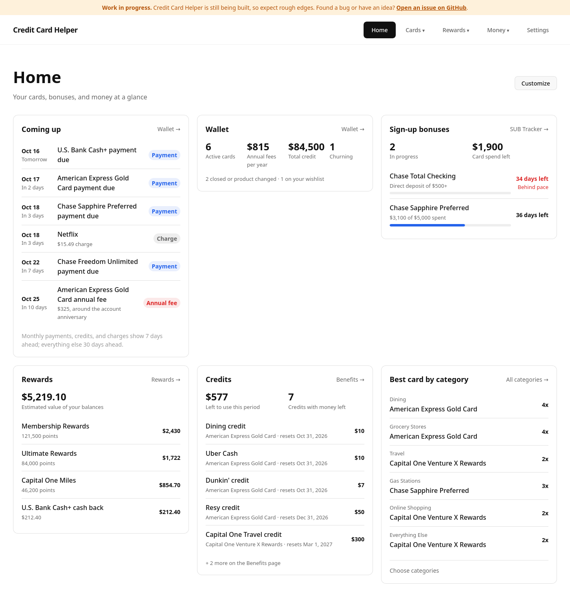
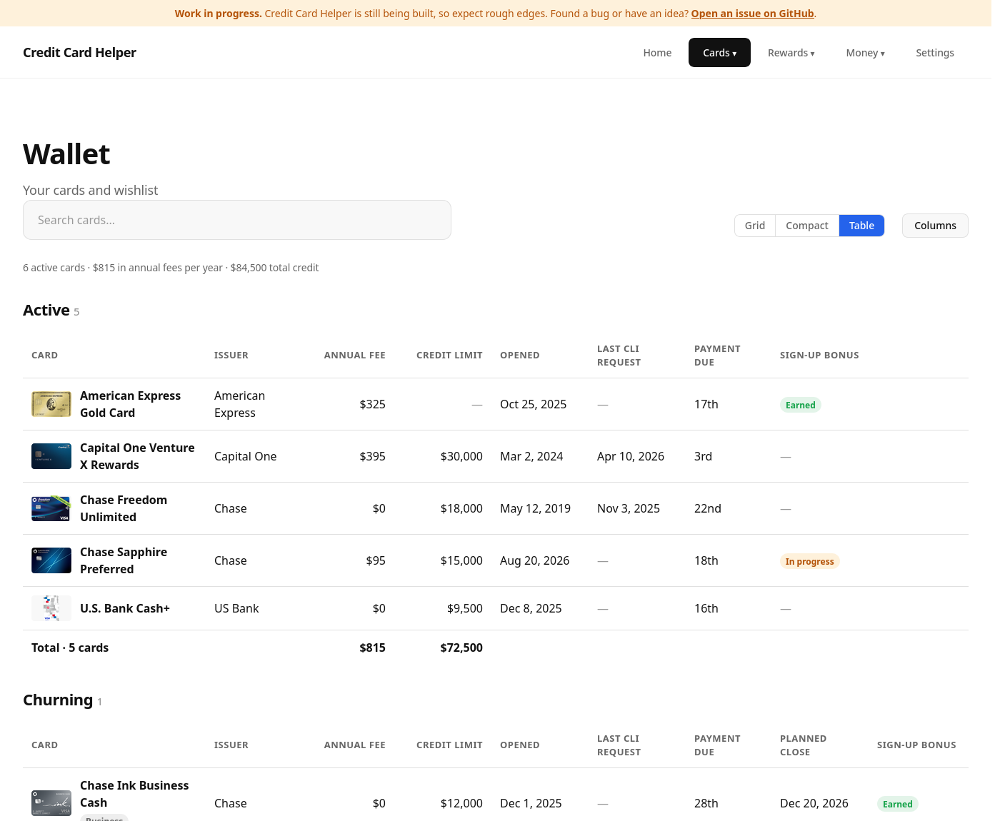
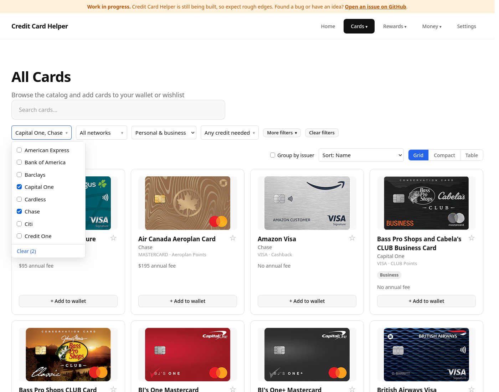
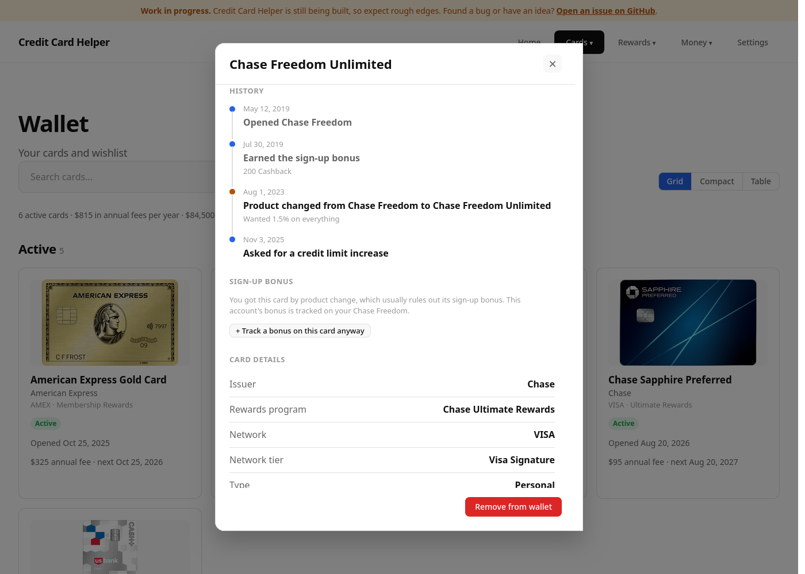
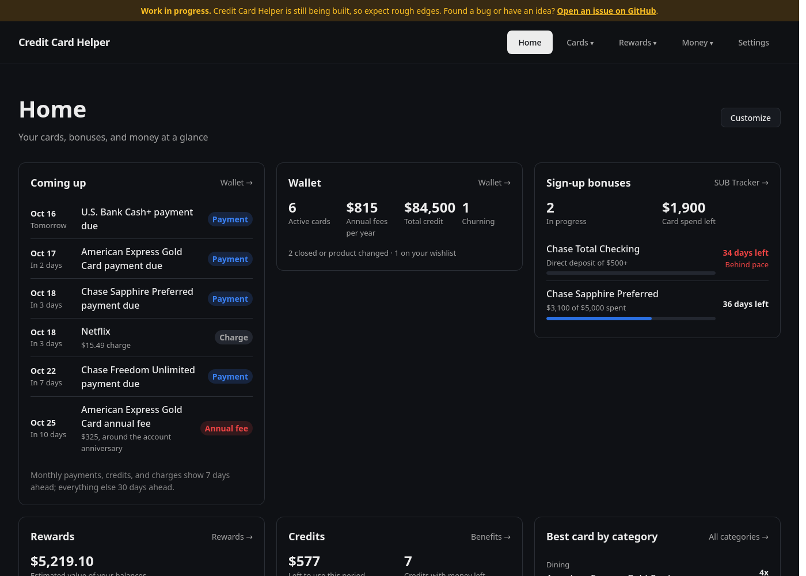

<div align="center">

# 💳 Credit Card Helper

**Track your cards, sign-up bonuses, rewards, and credits in one place, right in your browser.**

[](https://github.com/sjankowskim/credit-card-helper.github.io/actions/workflows/deploy.yml)


[**Open the app**](https://sjankowskim.github.io/credit-card-helper.github.io/) ·
[Report a bug](https://github.com/sjankowskim/credit-card-helper.github.io/issues) ·
[Request a feature](https://github.com/sjankowskim/credit-card-helper.github.io/issues)



</div>

## Table of contents

- [About](#about)
- [Features](#features)
- [Screenshots](#screenshots)
- [Your data stays with you](#your-data-stays-with-you)
- [Getting started](#getting-started)
- [Scripts](#scripts)
- [Project structure](#project-structure)
- [Adding or updating a card](#adding-or-updating-a-card)
- [Deployment](#deployment)
- [Built with](#built-with)
- [Disclaimer](#disclaimer)

## About

Credit Card Helper is for people who juggle several credit cards: chasing sign-up bonuses, keeping
track of statement credits, watching issuer rules like Chase 5/24, and deciding which card to use
where. It replaces the spreadsheet most of us end up keeping, with a catalog of **263 cards from 16
issuers** to build your wallet from.

There's no account to create and no server: everything you enter is saved in your browser.

## Features

**At a glance**

- 🏠 **Home**: customizable widgets that summarize every page. Add, remove, and reorder them, and choose
  what the Best card and Application rules widgets show.
- 📅 **Coming up**: one list of what's due soon: bonus deadlines, annual fees, planned closes, payment
  due dates, expiring credits, and subscription charges.

**Cards**

- 🗂️ **Card catalog**: search and filter by issuer, network, network tier, credit needed, annual fee,
  rewards type, and bonus category, picking as many of each as you like (e.g. Chase and Citi cards
  that earn a bonus on both dining and groceries). Grid, compact, and table views, with columns you pick.
- 👛 **Wallet**: your cards grouped into Active, Churning, and Closed & product changed. Track open
  dates, credit limits, payment due days, last credit limit increase requests, annual fee overrides,
  and why a card was closed or product changed. Add cards you got by product change, and see each
  account's history (opened, bonus earned, product changes, closed) in its details. Tables with
  totals, like your spreadsheet.
- 🏆 **Best card by category**: ranks your cards for every spending category, including rotating
  and pick-your-own categories, optionally valuing points at your own cents-per-point.
- 📋 **New accounts**: every account you've opened and where you stand with each issuer's application
  rules (5/24, 2/30, 1/8, and more), including when you can apply again.
- 🚫 **Discontinued cards**: tells apart cards you can still get by product change from cards that
  are gone for good.

**Rewards**

- 🎯 **SUB tracker**: sign-up bonus progress for cards and bank accounts, with deadlines, daily spend
  needed, and a warning when you fall behind pace.
- 💰 **Rewards**: balances by program, what each card has earned you, and redemptions.
- 🎟️ **Benefits & bonuses**: statement credits per period, retention offers, and referral bonuses.

**Money**

- 🔁 **Subscriptions**: recurring charges, their yearly cost, and when they renew.
- 🏦 **Loans**: balances, payoff dates, and how extra payments help.
- 📈 **Contributions**: yearly limits for 401(k), IRA, HSA, FSA, and other tax-advantaged accounts.

**Everywhere**

- 🌗 Light and dark mode (or follow your system).
- 📱 Works on phones.
- 💾 Export and import a JSON backup.

## Screenshots

| Wallet table | Card catalog |
| :---: | :---: |
|  |  |

| Card history | Dark mode |
| :---: | :---: |
|  |  |

<sub>Screenshots use made-up demo data.</sub>

## Your data stays with you

- Everything is stored in your browser's `localStorage`. Nothing is sent anywhere.
- There are no accounts, analytics, or trackers.
- Clearing your browser data erases it, so **export a backup** from Settings now and then. Import it to
  restore, or to move to another device or browser.

## Getting started

### Prerequisites

- [Node.js](https://nodejs.org/) 22 or newer
- npm (comes with Node.js)

### Run it locally

```bash
git clone https://github.com/sjankowskim/credit-card-helper.github.io.git
cd credit-card-helper.github.io
npm ci
npm start
```

Then open <http://localhost:4200/>. The app reloads as you edit files.

> [!NOTE]
> Run npm from the repository root. The repo's `.npmrc` keeps npm's cache in `.npm-cache/` inside
> the project, using a path relative to where npm runs.

## Scripts

| Command | What it does |
| --- | --- |
| `npm start` | Starts the dev server at `localhost:4200` |
| `npm run build` | Builds for production into `dist/` |
| `npm test` | Runs the unit tests with [Vitest](https://vitest.dev/) |
| `npm run gen-cards` | Rebuilds the card catalog index (runs automatically before `start`, `build`, and `test`) |

## Project structure

```text
src/app/
├── core/
│   ├── data/          # Card catalog, categories, issuer rules, contribution limits, widget lists
│   │   └── cards/     # One file per card, grouped by issuer
│   ├── models/        # TypeScript types for cards and saved app state
│   ├── services/      # State, storage and migrations, rankings, rewards, benefits
│   └── utils/         # Date math, bonus progress, upcoming events, formatting
├── features/          # One folder per page (home, cards, wallet, sub-tracker, rewards, ...)
└── shared/            # Reusable components: modal, navbar, checklist picker, charts
public/images/cards/   # Card artwork, mirroring core/data/cards
scripts/               # Card index generator
```

## Adding or updating a card

The catalog is plain TypeScript, one file per card.

1. Add a file under `src/app/core/data/cards/<issuer>/<card-name>.ts` that exports a `Card`. Copy
   a similar card as a starting point. The `Card` type in `src/app/core/models/card.model.ts`
   documents every field.
2. Set `termsCheckedOn` to the date you checked the terms against the issuer's site.
3. Optionally add artwork at `public/images/cards/<issuer>/<card-name>.png` (`.webp`, `.avif`, and
   `.jpg` work too). Extra designs go in `<card-name>-2.png`, `<card-name>-3.png`, and so on. Use the
   issuer's flat (not tilted) card art, cropped to the card's edges with transparent rounded corners
   and no shadow, about 300–640 px wide.
4. Run `npm start`. The card index is regenerated automatically and the card shows up in the catalog.

For a card that no longer takes applications, set `discontinued` to `'product-change-only'` if
existing cardholders can still switch into it, or `'retired'` if no one can get it anymore.

## Deployment

Every push to `main` builds the app and deploys it to GitHub Pages using the
[deploy workflow](.github/workflows/deploy.yml).

## Built with

- [Angular 22](https://angular.dev/) with standalone components and signals
- [TypeScript](https://www.typescriptlang.org/)
- [SCSS](https://sass-lang.com/) with CSS custom properties for theming
- [Vitest](https://vitest.dev/) for unit tests
- [GitHub Pages](https://pages.github.com/) and GitHub Actions for hosting

## Disclaimer

Card terms, bonuses, and issuer rules change often, and application rules are community data
points rather than published policy. Always check with the issuer before applying. This project
isn't financial advice and isn't affiliated with any card issuer.
